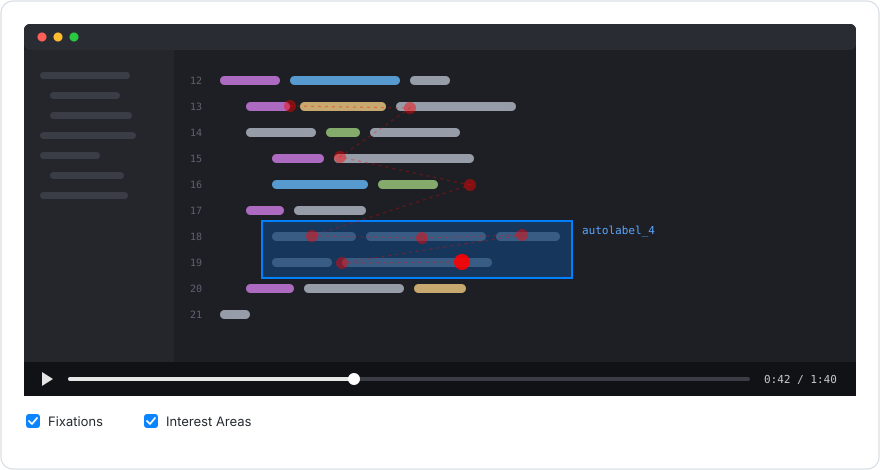

<h1 align="center">EyeViz</h1>

<p align="center">
  <b>Replay eye-tracking sessions in the browser.</b><br>
  A React component that plays a screen recording with the viewer's fixations<br>
  and interest areas drawn on top, in sync with the video.
</p>

<p align="center">
  <a href="https://www.npmjs.com/package/eyeviz"></a>
  <a href="https://github.com/Taremeh/EyeViz/actions/workflows/ci.yml"></a>
  
  
  <a href="LICENSE"></a>
</p>

<p align="center">
  <a href="#install">Install</a> ·
  <a href="#quick-start">Quick start</a> ·
  <a href="#input-files">Input files</a> ·
  <a href="#props">Props</a> ·
  <a href="#column-mapping">Column mapping</a> ·
  <a href="#example-app">Example app</a>
</p>

<p align="center">
  
</p>

<p align="center"><sub>A schematic of what the component draws, not a real recording.</sub></p>

## Why

Eye-tracking software exports fixations and interest areas as report files, and checking them against what
was on screen usually means going back to the vendor's own viewer. EyeViz reads those reports directly and
draws them over the screen recording on a web page, so you can check a mapping, show a session to a
co-author, or put a replay on a project site.

- **Fixations** are drawn as points for as long as each one lasts.
- **Interest areas** (IAs) are drawn as rectangles, circles or polygons. Dynamic interest areas appear and
  disappear at their own times, which suits content that moves, such as inline code suggestions.
- **Two checkboxes** under the video switch each layer on and off.
- **It is a `<video>` element underneath**, so every video prop and a ref to the element work as usual.

> [!NOTE]
> EyeViz is an early version. It is tested with fixation reports and dynamic interest areas (`.ias`) from
> SR Research EyeLink. Other formats work through [column mapping](#column-mapping) but are less tested.

## Install

```bash
npm install eyeviz
```

React and React DOM (17 or later) are peer dependencies.

## Quick start

```tsx
import { EyeViz } from 'eyeviz';

export default function Replay() {
  return (
    <div style={{ width: 800 }}>
      <EyeViz
        videoSrc="/screen-recording.mp4"
        fixationSource="/fixation_report.csv"
        iaSource="/interest_areas.ias"
      />
    </div>
  );
}
```

Each source can be a URL, a `File` or `Blob` (from a file input, say), or an array you parsed yourself.

### Next.js

EyeViz needs the browser, so use it in a Client Component. Importing it on the server is safe: it does not
touch `window` at import time.

```tsx
"use client";

import { EyeViz } from 'eyeviz';

export default function Page() {
  return <EyeViz videoSrc="/video.mp4" fixationSource="/fixations.csv" iaSource="/ias.ias" />;
}
```

## Input files

| Input | Formats | What EyeViz needs from it |
|---|---|---|
| Screen recording | anything the browser's `<video>` plays | |
| Fixation report | CSV, TSV, TXT, XLS, XLSX, or `FixationRecord[]` | x, y, start time, duration |
| Interest areas (optional) | `.ias`, CSV, TXT, XLS, XLSX, or `IARecord[]` | a shape, and optionally start and end time |

**Fixations.** Headers are detected automatically. EyeLink's `CURRENT_FIX_X`, `CURRENT_FIX_Y`,
`CURRENT_FIX_START` and `CURRENT_FIX_DURATION` are recognised, and so are common names such as `x`, `y`,
`startMs`, `timestamp`, `duration` and their variants in seconds.

**Dynamic interest areas (`.ias`).** Tab-separated, one area per line:

```text
# IA	start_time	end_time	shape	ID	x	y	right	bottom	label
-1176028	-1176284	RECTANGLE	1	387.77	605.00	713.28	671.00	autolabel_1
```

Times are in milliseconds, and a leading `-` is ignored. A rectangle is given by its top-left (`x`, `y`) and
bottom-right (`right`, `bottom`) corner. Set `iaTimestampUnit` if your times are in another unit.

**Interest areas in a table.** Rectangles as `x, y, width, height`, circles as `cx, cy, r`, polygons as a
`points` string (`"10,10; 50,10; 50,50"`) or as columns `x1, y1, x2, y2, ...`.

## Props

Only `videoSrc` and `fixationSource` are required.

**Sources**

| Prop | Type | Description |
|---|---|---|
| `videoSrc` | `string \| File \| Blob` | The screen recording |
| `fixationSource` | `string \| File \| Blob \| FixationRecord[]` | The fixation report |
| `iaSource` | `string \| File \| Blob \| IARecord[]` | The interest areas |

**Coordinates and timing**

| Prop | Default | Description |
|---|---|---|
| `coordinateSystem` | `'pixels'` | `'pixels'`, or `'normalized'` for coordinates from 0 to 1 |
| `fixationSurfaceSize` | the video's resolution | `{ width, height }` of the screen the fixations were recorded on, if it differs from the video |
| `iaSurfaceSize` | the video's resolution | The same for the interest areas |
| `timestampUnit` | `'ms'` | Unit of the fixation times: `'ms'` or `'s'` |
| `iaTimestampUnit` | `'ms'` | Unit of the interest area times: `'ms'`, `'s'` or `'us'` |
| `videoStartOffsetMs` | `0` | Shifts the fixations against the video |
| `iaTimeOffsetMs` | `0` | Shifts the interest areas against the video |
| `normalizeFixationTime` | off | Subtracts the earliest start from all fixations, so the first one is at 0 |
| `normalizeIATime` | off | The same for the interest areas |

**Appearance**

| Prop | Default | Description |
|---|---|---|
| `initialShowFixations` | `true` | Whether the fixation layer starts switched on |
| `initialShowIAs` | `true` | Whether the interest area layer starts switched on |
| `pointColor` | `'rgba(255, 0, 0, 0.8)'` | Colour of a fixation point |
| `pointOpacity` | `0.9` | Opacity of a fixation point |
| `pointRadiusPx` | `6` | Radius of a fixation point |
| `iaFillStyle` | `'rgba(0, 128, 255, 0.25)'` | Fill of an interest area |
| `iaStrokeStyle` | `'rgba(0, 128, 255, 1)'` | Outline of an interest area |
| `iaLineWidth` | `2` | Outline width |
| `iaOpacity` | `0.25` | Opacity of an interest area |

A single fixation or interest area can carry its own `color` and `opacity`, which win over these.

**Parsing and events**

| Prop | Description |
|---|---|
| `fixationColumnMap` | Names of your fixation columns, see [Column mapping](#column-mapping) |
| `iaColumnMap` | Names of your interest area columns |
| `iaRowToShape(row)` | Builds a shape from a raw row, for reports that have no geometry |
| `onParseError(error)` | Called when a file can't be read |
| `onReady()` | Called when the video's metadata has loaded |

All other props go to the `<video>` element (`loop`, `muted`, `autoPlay`, `onTimeUpdate`, ...), and a `ref`
gives you the element itself:

```tsx
const video = useRef<HTMLVideoElement>(null);

<button onClick={() => { if (video.current) video.current.currentTime = 10; }}>Jump to 0:10</button>
<EyeViz ref={video} videoSrc="/video.mp4" fixationSource="/fixations.csv" muted />
```

## Column mapping

When your columns have other names, say which is which:

```tsx
<EyeViz
  videoSrc="/video.mp4"
  fixationSource="/fixation_report.csv"
  iaSource="/ia_report.txt"
  fixationColumnMap={{
    x: 'CURRENT_FIX_X',
    y: 'CURRENT_FIX_Y',
    startMs: 'CURRENT_FIX_START',
    durationMs: 'CURRENT_FIX_DURATION',
  }}
  iaColumnMap={{ x: 'left', y: 'top', width: 'width', height: 'height', label: 'IA_LABEL', id: 'IA_ID' }}
/>
```

`fixationColumnMap` also takes `startSec`, `durationSec`, `endMs`, `radiusPx`, `color`, `opacity` and `id`.
`iaColumnMap` takes `cx`, `cy`, `r` for circles and `points` for polygons.

If an interest area report lists the areas without their geometry, build the shapes yourself. Return `null`
for a row that should not be drawn:

```tsx
<EyeViz
  videoSrc="/video.mp4"
  fixationSource="/fixation_report.csv"
  iaSource="/ia_report.txt"
  iaRowToShape={(row) =>
    String(row['IA_ID']) === '1'
      ? { type: 'rect', rect: { x: 100, y: 100, width: 200, height: 150 }, label: String(row['IA_LABEL']) }
      : null
  }
/>
```

## Types and parsers

```ts
import type { EyeVizProps, FixationRecord, IARecord } from 'eyeviz';
import { parseFixationsFromSource, parseIAsFromSource } from 'eyeviz';
```

- `FixationRecord`: `{ x, y, startMs, durationMs, radiusPx?, color?, opacity?, id? }`
- `IARecord`, one of:
  - `{ type: 'rect', rect: { x, y, width, height } }`
  - `{ type: 'circle', circle: { cx, cy, r } }`
  - `{ type: 'polygon', polygon: [{ x, y }, ...] }`

  each with optional `id`, `label`, `color`, `opacity`, `startMs` and `endMs`.

The two parsers are the ones the component uses. Call them yourself to read a report once and pass the
arrays on.

## Example app

[`examples/nextjs-app`](examples/nextjs-app) is a minimal Next.js page that shows the component with the
sample reports in [`data/`](data). It expects a screen recording that you add yourself; its
[README](examples/nextjs-app/README.md) has the steps.

## Development

```bash
npm install
npm test            # parser tests, including the sample reports in data/
npm run typecheck
npm run build       # ESM, CommonJS and type definitions into dist/
npm run dev         # the same, rebuilding on change
```

## License

[MIT](LICENSE)
